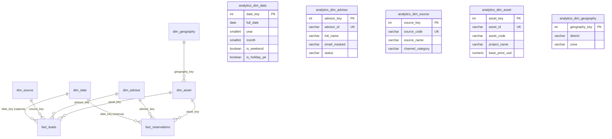

# EVIDENCE PACK — SPRINT 1: DATA FOUNDATION (FASE 4)
## Célula Alpha — Zenplus OS

| Atributo | Detalle |
| :--- | :--- |
| **Fase** | Fase 4 — Data & Management Intelligence |
| **Sprint** | Sprint 1: Metric / Data Foundation |
| **Tickets Cubiertos** | **ALP4-001** (Must), **ALP4-002** (Must), **ALP4-003** (Must) |
| **Responsable** | Equipo 1 (Data Foundation) |
| **Estado** | **DONE (Completado y Verificado)** |
| **Exit Gate Readiness** | Apto para revisión del Líder Alpha y Líder General |

---

## 1. Resumen Ejecutivo del Sprint 1

En este Sprint 1 se construyeron los cimientos arquitectónicos, de gobernanza y de modelado dimensional que sustentan toda la analítica de **ZENPLUS OS**. Se garantizó el aislamiento total respecto a la base transaccional (OLTP) y se dejó disponible la infraestructura para que los equipos subsiguientes implementen los hechos comerciales (Leads, Oportunidades, Reservas) y transaccionales (Operaciones, Snapshots de Inventario).

### Entregables Clave:
1. **Esquema Aislado y Naming Standard (ALP4-001):**
   - Creación del esquema `analytics` sin alterar ni acoplar las tablas operacionales en `core`, `inventory` o `crm`.
   - Convenciones estrictas de prefijos (`dim_*`, `fact_*`, `snap_*`, `vw_*`) y zonas horarias (`America/Lima` / UTC).
   - Documento normativo: [`ALP4-001_analytics_schema_naming_standard.md`](./ALP4-001_analytics_schema_naming_standard.md).

2. **Definición de Grano, Claves y 5 Metric Contracts P0 (ALP4-002):**
   - Grano unívoco formalizado para cada entidad transaccional y acumulativa.
   - Separación estricta de Surrogate Keys (`*_key`) vs Natural Keys (`*_id`).
   - Política de fallback key (`-1`) para garantizar que ningún `INNER JOIN` descarte filas en presencia de nulos.
   - Formalización de los **5 Metric Contracts P0 obligatorios**:
     - `M-01: metric_leads_captured_total`
     - `M-02: metric_lead_to_reservation_conversion_rate`
     - `M-03: metric_active_reservations_amount_usd`
     - `M-04: metric_operations_cycle_time_days`
     - `M-05: metric_inventory_availability_ratio`
   - Documento contractual: [`ALP4-002_metric_grain_keys_and_p0_contracts.md`](./ALP4-002_metric_grain_keys_and_p0_contracts.md).

3. **Dimensiones Core Modeladas, Migradas y Pobladas (ALP4-003):**
   - 5 dimensiones maestras implementadas con DDL idempotente, índices de alto rendimiento y constraints de unicidad:
     - `analytics.dim_date`: Calendario completo 2024–2030 (2,557 días) con año, trimestre, mes, día, ISO week, flags de fin de semana y feriados peruanos oficiales.
     - `analytics.dim_geography`: Estructura geográfica normalizada (País, Departamento, Provincia, Distrito, Zona comercial).
     - `analytics.dim_advisor`: Registro de asesores con enmascaramiento PII (`email_masked`).
     - `analytics.dim_source`: Canales de captación categorizados (Digital Orgánico, Digital Pagado, Directo, Referido, Presencial).
     - `analytics.dim_asset`: Catálogo dimensional de activos inmobiliarios con precio base USD, área m2, tipo y estado actual.
   - Documento de diccionario: [`ALP4-003_core_dimensions_dictionary.md`](./ALP4-003_core_dimensions_dictionary.md).

---

## 2. Diagrama de Relación Dimensional (Star Schema Foundation)

---

## 3. Artefactos de Código Entregados

| Tipo de Artefacto | Archivo / Ubicación | Propósito |
| :--- | :--- | :--- |
| **Migración SQL DDL** | [`apps/api/src/db/migrations/003_create_analytics_schema_and_dimensions.sql`](../../apps/api/src/db/migrations/003_create_analytics_schema_and_dimensions.sql) | DDL versionado del esquema `analytics` y las 5 dimensiones. |
| **Tipos TypeScript** | [`apps/api/src/modules/analytics/analytics.types.ts`](../../apps/api/src/modules/analytics/analytics.types.ts) | Modelos e interfaces para TypeScript y contratos de métricas. |
| **Servicio ETL** | [`apps/api/src/modules/analytics/dimensions.service.ts`](../../apps/api/src/modules/analytics/dimensions.service.ts) | Algoritmo de población de fechas, sincronización idempotente y PII masking. |
| **Script de Población** | [`apps/api/src/scripts/seed-analytics-dimensions.ts`](../../apps/api/src/scripts/seed-analytics-dimensions.ts) | Ejecutor de migración y población en la base de datos PostgreSQL. |
| **Script de Verificación QA** | [`apps/api/src/scripts/verify-analytics-foundation.ts`](../../apps/api/src/scripts/verify-analytics-foundation.ts) | Test automatizado de grano, claves, integridad y fallback keys (-1). |

---

## 4. Checklist de Criterios de Aceptación (Definition of Done)

- [x] **Aislamiento OLTP:** El esquema `analytics` se encuentra aislado y no añade claves foráneas directas que bloqueen las operaciones de escritura en `crm`, `inventory` o `core`.
- [x] **Grano Documentado:** Cada entidad crítica cuenta con definición explícita de grano a nivel de fila.
- [x] **5 Metric Contracts P0 Aprobados:** Redactados conforme al estándar institucional con fórmula, fuente autorizada, timezone, filtros y owner.
- [x] **Fallback Key (-1) Implementado:** Todas las dimensiones cuentan con registro predeterminado `-1` para evitar exclusiones accidentales de métricas por nulos.
- [x] **Seguridad y Privacidad (PII Safe):** Enmascaramiento de correos en `dim_advisor` para visualización segura en BI y dashboards sin exponer datos personales sensibles.
- [x] **Idempotencia:** Todos los scripts SQL y procesos ETL soportan re-ejecución mediante `ON CONFLICT DO NOTHING / UPDATE`.
- [x] **Scripts de NPM Registrados:** Comandos `npm run db:analytics:seed` y `npm run db:analytics:verify` disponibles en `apps/api`.
